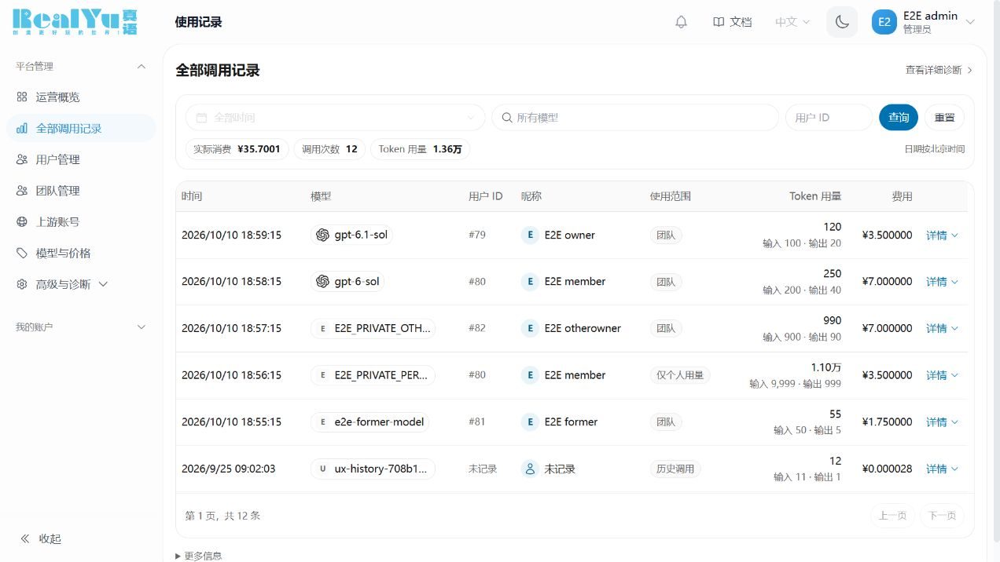

# UX6：恢复 RealYu 调用记录的紧凑视觉

发布状态：候选已验收；17:05 的 r2 更新因 30 秒内未排空而在停止服务前取消，入口已恢复，线上仍为 UX5。后续实际发布以根目录 [LIVE-DEPLOYMENT](../../LIVE-DEPLOYMENT.md) 的最新记录及 ACTIVE 回执为准，不能凭 Git 版本推定已经上线。

17:31 发起包含图标的 r4 系统提权，返回 `UAC_NOT_STARTED`，没有执行回执；最终候选已经具备，但仍需完成 Windows 管理员提权。r2 的接纳门关闭30.162秒，既有监控保留9个维护失败样本；重开后至17:34:21六路径各171/171通过，两Tunnel各4连接，最大间隔10.017秒，读取时新鲜度4.152秒。这只说明该采样窗口，见[首次取消后的观测](../../lab/sub2api_e2e/ux6-abort-observation-20261011.json)。

## 改动范围

本次落实已确认的[旧版视觉基线](UI-VISUAL-BASELINE-20261011.md)，集中优化 `/usage`、`/admin/usage`。保留 RealYu Logo、首页链接、蓝色与中性底色、现有工作台和菜单；手机补齐品牌标识，并在 320px 下收为品牌图标以免挤压菜单。

- 常用日期、模型、管理员用户 ID 筛选收在一个紧凑面板，统计改为内嵌短条。日期支持全部时间、今天、近 7 天和近 30 天，继续按北京时间解释；取消不会提交草稿。
- 桌面八列为时间、模型、用户 ID、昵称、使用范围、Token、费用、详情。昵称与 ID 分列；金额和 Token 右对齐、等宽数字；输入/输出作为次级信息，详情按需展开。
- 手机使用记录卡片，模型和人民币费用在首行；昵称、ID、用量就近显示。日期保留，其他条件放底部筛选面板；点击区域保持 44px。
- 共用弹窗支持可选底部/侧边面板和焦点循环、Esc 关闭及焦点返回，默认居中行为保留。中文、英文和明暗主题均有对应样式。

模型恢复已有厂商 SVG 标识（包括 GPT），昵称前恢复首字圆形头像；使用蓝色和中性色，不请求第三方头像接口。未知昵称用人物轮廓，名称仍显示“未记录”。

没有新增业务接口、数据库迁移、重算资金或导入历史。原有实际消费、总调用数、Token、分页、个人/团队权限和历史归属含义保持。旧记录缺失的缓存字段显示“未记录”，不会填成零。没有同时引入 React 或第二套前端运行时。

## 源码与可重建交付

| 项目 | 固定身份 |
|---|---|
| 应用版本 | `realyu-singlecore-v0.2.15-20261011-ux6` |
| 原生源码提交 | `a631266bde77db86b5b530cc4fccb7b6aba1013f` |
| 固定 Sub2API 上游 | `f2669c8cf62555cd92389b3f55920e9e6e7c6ff2` |
| 完整补丁 SHA256 | `20a90f1bc034ca24d7500bc1561e6530519efb8feaca83994b1b9ae9f319e4de` |
| 本机最终 binary SHA256 | `26aaecdbab17baeb86e9f984cf66d3b8c99a51542845b0b73603827f26298cc7` |
| 重建核对 | 409 个相对上游改动文件逐一一致 |
| 相对 UX5 的原生改动 | 9 个前端源码/测试文件，无后端和 migration 变更 |

完整代码在 `singlecore-candidate.patch`，版本和文件哈希在 `singlecore-source.json`。原生目录的本地 Git remote 不是 GitHub 交付入口。另一台机器使用交接分支和 `Prepare-SingleCore.ps1 -Build -Test` 重建；不同工具链产物记录自己的哈希，不冒称和本机 binary 一致。

## 实际验证

| 层次 | 已完成结果 | 边界 |
|---|---|---|
| 前端较完整回归阶段 | 94 文件、1021 测试通过 | 阶段性结果；不能称为最后两处 CSS/品牌尺寸调整后重跑全部测试 |
| 最后交互修正定向回归 | 10 文件、73 测试通过 | 日期/使用记录/布局/共用弹窗；与上述计数重叠，不相加 |
| 日期与范围语义 | 北京时间跨日/年界、7/30 天、开放边界、反向日期、取消和 Esc | 自动化测试，无设备时区替代业务时区 |
| 补齐图标后的回归 | 37 项记录页回归、Vue 类型检查通过 | 后续仅 CSS 列间距微调，并已实看最终 r6 |
| 类型与构建 | Vue 类型检查、Vite、Go embed binary 均通过 | 最终 r6 构建；最后两处只涉及表格尺寸和品牌布局 |
| 补丁可交付性 | 409/409 重建文件哈希匹配 | 原生完整补丁，无运行私有资料 |
| 发布保护 | r2、r3、r4 各 15 个准备器保护测试；公网只读验收器 11 个保护测试通过 | 不等同已发布或已跑公网验收 |
| 候选浏览器 | 管理员、团队管理员、成员、退出团队用户、空结果；查询/重置/日期/范围/前进后退/详情 | 独立 PG/Redis、禁用真实上游；没有付费模型调用 |
| 视觉与键盘 | 1280/1440 桌面、390/320 窄屏；中文/英文、浅色/深色；筛选面板 Tab 循环、Esc、返回焦点 | 未测实体手机、操作系统 200% 缩放，不宣称完整无障碍认证 |

1280px 中文表头从原线上 y≈329px 前移到 y≈232px；英文表格最终宽度 1013px，与容器一致，费用和详情无需横滑。390px 手机首条记录从原线上 y≈659px 前移到 y≈311px，页面宽 382px；320px 英文最终页宽/页头宽均为 320px。1440px 中文页宽 1432px，八列完整。以上是固定视口样本，不是所有内容长度的保证。

候选真实浏览器还确认：普通成员不可进入管理员页；退出团队后没有团队管理入口，旧团队链接被拒绝；管理员模型与用户 ID 联合筛选返回正确记录；团队页与个人页的计数/费用分离。历史详情的缓存读取/写入保持“未记录”，既有耗时仍显示原值。

## 首次失败与修正

1. 暗色作用域选择器使辅助文本/标签颜色错误；浏览器发现后修复并重看暗色页面。
2. 英文桌面表格最初 1096px 超过 1013px 容器；收紧单元格和模型宽度后完整显示八列。
3. 320px 英文页头最初因 Logo 扩到 374px；改为响应式品牌图标/字标后为 320px。
4. 首次补丁复原在导出尚未完成时读取到不一致的哈希；保留失败，等待导出结束后在新目录重建通过。
5. 首次候选启动受进程执行策略拦截；仅在该次启动使用 RemoteSigned，未修改全局策略。
6. UAC 首次未启动；重新发起成功后，r2 在 30 秒排空预算到期时返回 `ABORTED_BEFORE_STOP / DRAIN_TIMEOUT_NO_STREAM_KILLED`，未停 API、未恢复数据库，入口重开。失败回执保留，不能重放同一 operation。
7. 浏览器曾因 resize 动画截到中间态、错误假设详情是 dialog 或按空格匹配表格文本而超时；按实际 DOM 重新定位后通过。它们不作为生产故障或被掩盖的产品通过项。

## 部署和服务器接手

新机先读[整站接手入口](SERVER-MIGRATION-START-HERE-20261011.md)。当前权威库有 300 项 migration，最新 308；此次程序更新沿用同一 PG/Redis、Key 与代理。16:42 的一致快照已在隔离库恢复核对：127 表、94,213 行、全部哈希一致；这份快照不能覆盖之后产生的交易，新机最终切流需要更新的快照。

同机发布只使用新生成并固定哈希的本机计划：正常 Windows 提权、关闭接纳、最多 30 秒排空、SCM 更新、核验后开门。排空失败则开门退出，不强杀请求；回退只能指向同一当前数据库，不得恢复旧财务快照。r2 已取消，不再运行。r3 等待空闲的启动器已因用户要求补齐图标而停止，入口脚本封存，未激活；当前 r4 为包含图标的最终本机计划。Git 不保存私有计划、凭据、完整数据库或客户截图。

公网验收入口：`lab/sub2api_e2e/verify_ux6_public_20261011.py`。默认离线，只有显式 `--released --expected-sha256 <已核验binary SHA>` 才执行；校验运行版本/服务归属、直连/代理/本地路径、历史与趋势、团队昵称与汇总及币种。只允许既有管理员登录与只读请求，保留首错、不静默重试、不调用模型。

候选测试、构建、备份和来源证据位于 `lab/sub2api_e2e/ux6-*.json`。部署后的公开页面和既有十秒观测需要独立记录；候选通过不能替代公网验收。部署交接仍需保留原先已记录的 Redis 跨机续聊、目标机独立性和真实商户等验收边界。

## 最终图标补充

GPT 标识与头像在 r6 实际候选中已核验：1280px 英文暗色表格的 scrollWidth/clientWidth 均为 1013；320px 英文页宽 312，头像24px、标识18px、费用完整可见。390px 中文管理员首条卡片 y=256.5，1440px 表格宽1173且没有横向溢出。两条合成记录临时使用 GPT 模型名验证标识，随后恢复原模型标签；这不是付费模型调用证据。昵称头像的新增字母曾使3个旧文本断言失败，改为读取实际昵称节点后37项通过。

[手机英文暗色候选，合成数据](../../lab/sub2api_e2e/ux6-mobile-synthetic.png)
