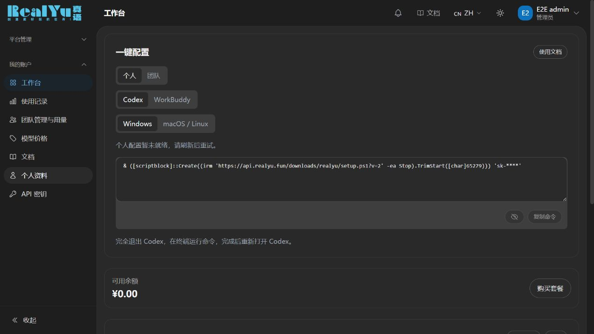
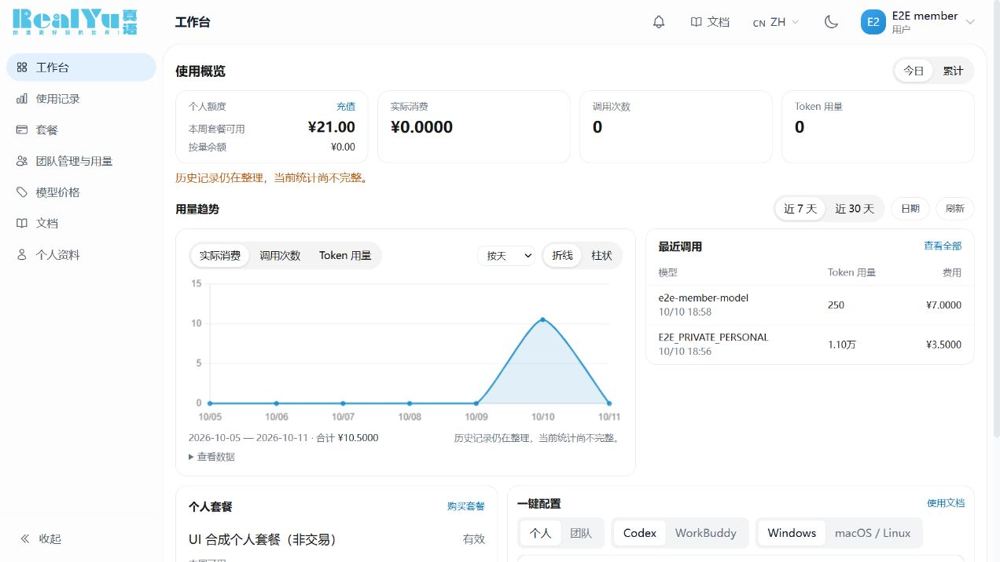

# UX3 独立视觉与需求完成度审查

审查时间：2026-10-11。状态：本轮独立审查完成。审查源码 `C:\srv\realyu-singlecore-dev\source`，基线 f98d4b6 后的改动，最后独立核对至干净 HEAD `3f13f202765f2d9473664f3ec239f71d187adecf`。

只读检查代码与本次审查由主流程捕获的浏览器截图；未操作生产、共享浏览器、资金、数据库或 Git。报告文件是唯一写入。使用 Product Design audit 流程，已运行只读 context preflight（无保存的 context）。本 reviewer 已用 view_image 逐张打开以下截图，未以测试通过代替视觉检查。旧版用户需求由用户明确要求的历史会话矩阵及原源码作比较依据，不把旧截图冒充本次验收。

## 最终判断

**本轮重点页面的视觉验收通过，未发现未解决的 P0/P1 视觉问题。** 工作台与管理员概览已经把额度/统计、完整趋势及近期调用放进桌面首屏；团队默认一人一行、按需展开模型，操作归入“…”；中英文与390px抽样中，页面边界和可读性明显优于初版。已处理的具体问题为首屏大配置卡/留白、周权益可见性、深色灰字对比、移动表格姓名丢失/长模型裁切、成员限额术语；Top up 换行和菜单术语最后一轮为源码复核，不冒称已单独再截图。

这不是“全部35项旧需求100%完成”，也不是生产发布、真实商户收款、客户端安装或完整无障碍认证。下面保留每次实际发现及初次失败；此前失败没有被后续截图覆盖。

## 已查看的流程

| 步骤 | 画面 | 观察结论 |
| --- | --- | --- |
| 1 | before-workbench-desktop.jpg | 旧候选深色工作台：首屏主要为约480px高的一键配置卡，按量余额在其下，统计与趋势不在首屏。用户关于低信息量横向大卡的反馈成立。 |
| 2 | after-workbench-admin-dark-desktop-r2.jpg | 新候选深色工作台：摘要四项在顶端，套餐与配置并列，趋势及最近调用开始进入首屏。层级比步骤1清楚，但无套餐空状态下左列仍有约180px高无内容区域。 |
| 3 | after-workbench-owner-light-desktop-r2.jpg | 新候选 owner 浅色：当前是“配置加载失败，请重试”错误态，不能用作正常配置成功证据。错误说明有文字及重试按钮。套餐空状态与配置卡高度不匹配更明显。 |
| 4 | before-team-fixture-desktop.jpg | 团队旧候选：概要卡约196px高但只有三项事实；成员操作按钮换行，列密度不均，暗色次要文字偏暗。改造后对照步骤8/9。 |
| 5 | after-workbench-member-light-desktop-r3.jpg | 新候选正常 member 浅色：顶部周权益¥21/按量¥0独立呈现，完整7天趋势及2条近期调用均在首屏；套餐详情与配置位于次要区域。此图以合成非交易套餐验证展示，不证明真实授予/购买发生。 |
| 6 | after-workbench-member-en-mobile-settled-r3.jpg | 英文390px浅色全页：摘要两列、趋势、最近调用、套餐与配置自然纵向展开；无可见页面横向溢出；三组接入按钮各自左右切换，配置及操作完整可见。合成套餐名称是业务数据，不属于翻译漏项。 |
| 7 | after-workbench-member-en-mobile-dark-settled-r3.jpg | 英文390px深色首屏：主数字和次要文字可读，趋势可见。该图只覆盖到趋势下沿，不是整页深色验收；Top up 被拆为两行，建议加 nowrap。 |
| 8 | after-team-owner-en-dark-menu-r4.jpg | 英文深色团队管理桌面菜单：各成员姓名与数值列均可见，表头适当折行，操作收为一列“…”；菜单4项完整显示，不再出现旧版按钮各自换行。该画面已滚动，不作为顶部坐标测量。 |
| 9 | after-team-owner-en-dark-mobile-menu-r4.jpg | 英文390px团队菜单：成员姓名及操作列固定，中间数据区独立横滑；菜单在视口内完整显示。页内表格滚动条可见，未见页面整体横溢出。实际键盘/触屏滚动仍由主流程验收。 |
| 10 | after-paygo-en-mobile-dark-r3.jpg | 英文390px按量余额关态：余额¥0及Out of stock明确；套餐fixture为空，显示No subscription plans available。本图证明关态入口可见，不证明六档销售页面或真实收款能力。 |
| 11 | before-admin-desktop.jpg | 管理员旧候选：摘要、四个入口、折叠详情以外大半首屏空白；改造后对照步骤12。 |
| 12 | after-admin-zh-dark-desktop-final.jpg | 管理员中文深色：三项概要、完整7天趋势、带调用人昵称的5条近期调用、诊断折叠入口都在首屏；改善了步骤11的大片空白。数据均为E2E测试用户，不是客户名单。 |
| 13（失败保留） | after-team-en-mobile-summary-final.jpg | 修复前英文390px团队汇总展开：表内横滑后成员名被隐藏，长模型及数值在边缘裁切。不得当通过。主流程随后修复，最终复核见步骤14–16。 |
| 14 | after-team-zh-desktop-summary-final2.jpg | 中文桌面汇总展开：同一成员一行580 Token / ¥8.75，其下两种模型明确从属，长模型名换行；其他成员继续按费用降序展示，不再在主列表重复人名。 |
| 15 | after-team-zh-mobile-summary-final2.jpg | 中文390px汇总关闭态：成员昵称与ID可见，数字区单独横滑，详情默认收起；姓名丢失问题在默认态已改善，展开态另见步骤16。 |
| 16 | after-team-zh-mobile-expanded-final2.jpg | 中文390px最终展开态：E2E member / #80保留，两个模型均可读，长模型名自然折成三行；明细默认收起。费用/Token在表内横滑区域，不要求所有数据强塞进390px。此图完成步骤13失败的视觉复核。 |

桌面工作台/团队图实际为1272×716，before-admin为1280×720；移动首屏图为382×827，英文移动全页为382×1818。1280×720与390px是主流程请求的浏览器观察范围，截图不是严格同数值像素输出。原始本机截图扩展名为.png，实际编码JPEG；本Git交付保留原字节并以.jpg扩展名保存，均可正常解码。本 reviewer不将这些截图用于像素级旧版复刻断言。

## 第一轮发现

### V1 / P2，r3 已解决首屏问题：双列高度差让空状态留白

步骤2左侧套餐卡在约y354结束，右侧配置卡到y533，趋势标题在y560；实际图形只露出约60px。步骤3的错误态进一步把趋势压到y600附近。原 `workspace-overview.tsx` 使用两张紧凑指标卡、左右两列（左Key与权益、右配置）及短操作入口；新版恢复方向相符，但不能仅凭改成两列称首屏密度已完整恢复。

建议优先收紧配置结构：标题与文档文字链接同行；减少独立上下空隙；复制/显隐与末尾说明使用统一底部操作区；保留14px正文及清楚的主数字，避免所有字整体缩小。对无套餐空状态可采用更紧凑布局或把最近调用与套餐放同一左列，避免空状态决定整排高度。修复后同视口重新检查趋势与至少一条调用记录是否完整可见。

独立 r3 目视复核：步骤5已将趋势/最近调用前置到约y250–610，整张趋势和两条近期调用均完整可见；个人资金卡清楚，配置及套餐详情从约y622开始。此版通过调整主次与结构解决首屏低信息问题，没有压小主体数字。只有两条真实fixture调用，近期区较短是内容本身，不应为填满页面制造记录。步骤6/7随后完成英文390px抽样；步骤12也确认管理员首屏改善。

### V2 / r3 已改善核心理解，仍有旧scope缺口

`DashboardView.vue` 摘要为个人“按量余额”，个人周权益在另一卡；`RealYuWorkspaceSetup` 里的个人/团队切换只更换接入Key，未同时切换额度/统计。旧 `workspace-overview.tsx:70–100,132–190` 将真实可调用额度及按量/当前周权益分项置顶，并使用同一资金scope。

因此“钱包0但有效周权益>0”仍不能从第一项直接知道能用多少。当前文字并未把钱包谎称为可调用额度，这是正确的；但需求等价性仍未完成。应避免为了视觉合并直接把团队池和个人钱包相加。后续如要恢复总额度，应由相同权威scope提供可用额及分项。

独立 r3 复核：新顶部卡已改为“个人额度”，并列“本周套餐可用¥21 / 按量余额¥0”；页面不再给出钱包0即不可调用的视觉暗示。源码只使用同一用户的一份有效managed个人权益，未知/冲突显示破折号，不把两个池无条件相加。核心理解问题已解决。工作台仍没有旧版由同一个个人/团队选择驱动所有余额/统计的全局scope，因此这一项记录为未完整等价，而不是当前视觉发布阻塞。

### V3 / P2，已修复源码：深色次要文字存在低对比度风险

`RealYuTeamsView.vue` 第43–46、65、77、95–100行等新增紧凑区域使用 `text-gray-500`，没有对应深色覆盖。当前品牌深色卡面为#292929；Tailwind gray500 #6b7280 与此背景计算对比约3.01:1，步骤4目视也较灰。品牌 `dark-400` 为#acacac，对同背景约6.41:1。

建议为这些次要标签、ID、状态、筛选说明补 `dark:text-dark-400`。用亮度提高可读性即可，无须增加装饰颜色。本计算来自声明的颜色值，未检查全部浏览器computed style，也不构成全站无障碍符合性结论。

后续独立源码复核：团队页上述位置现均已补 `dark:text-dark-400`，可见表格ID、状态、筛选说明与菜单触点都采用现有中性深色token。问题在代码层已处理；等待本次新深色团队截图确认视觉效果。作者报告的33项测试不作为本 reviewer 的目视结论。

独立 r4 目视复核：步骤8/9的团队ID、状态、说明与筛选标签已明显亮于旧图，深色可读性问题已改善。桌面单行成员阅读顺序清楚，移动姓名/操作固定，菜单未被容器边缘裁掉。

### V4 / P2局部换行与剩余验收限制

步骤3配置失败，不可作为成功态。步骤5是正常member顶部布局证据；步骤6已补充英文390px完整页面含配置下半部，布局可读，未见横向溢出。步骤7顶部个人额度卡的 Top up 拆为两行，建议链接加 `shrink-0 whitespace-nowrap`，不需要减小字号。这里不影响充值权限，只是狭窄可点文字的识别度。

团队菜单边缘定位已从步骤8/9验证可见；管理员、中文390px、实际成员汇总及模型展开随后由步骤12/14/15/16补齐。菜单键盘Esc与焦点回归仍不能仅靠截图声称已实测。主流程保留的 `after-workbench-member-en-mobile-r3.jpg` 为viewport过渡中间帧，本 reviewer 未把它作为稳定页面证据；步骤6/7是稳定后补取的画面。DOM宽度和真正的键盘行为仍以主流程实测记录为准，截图不能独立证明。

### V5 / P2，已修复源码：成员消费上限的操作术语应统一

步骤8/9英文菜单显示 Edit weekly allowance，源码 `en/realyuTeams.ts:3` 如此；中文为“调整每周额度”。同页字段却正确称 Weekly cap / 周限额，说明也强调只是限制消费，不向个人转入资金。建议菜单同步为 Edit weekly cap / 调整每周限额，与真实合同及弹窗字段一致。这是文案不一致，不是当前接口创造资金的问题。

后续独立源码复核：en/zh 已分别改为 Edit weekly cap / 调整每周限额；Dashboard充值链接已加入 `whitespace-nowrap`。两项小问题均已处理源码，待最终菜单画面补验。

### V6 / P2，final2 已解决：移动团队汇总横滑后身份与模型列被隐藏（主流程已发现）

步骤13可见汇总人数值但看不到对应成员，模型展开行在两侧被截断，不满足用户“一人一行直观比较”的手机要求。该问题不是分页/归属数据证据；它是表格展示问题。主流程已报告在最终构建中让汇总首尾列固定、长模型换行、嵌套表固定宽度，并修正sr-only绝对定位造成的页面横向溢出。本 reviewer 保留原异常，等待 final2 截图后才能将视觉项标为解决。

后续独立复核：步骤14桌面长模型已自然换行、层次清楚；步骤15手机默认汇总恢复成员姓名，并保留独立横滑条。步骤16已打开并检查真实展开态：成员 E2E member/#80及两模型名称均可读，长名称分三行，不再被画面左边缘裁切。数值列在512px表内横滑属于明确的窄屏取舍，并未伪称所有列可同时可见。主流程另报根 clientWidth/scrollWidth 均为382；此 DOM 数值不是 reviewer 自行执行的测量。

## 源码中可确认的改进（仍需交互/视觉验收）

- 工作台：统计前置、套餐与配置并排；四项数字使用中性表面，链接统一蓝色；趋势只使用一条主色，不以多种颜色装饰每一项。
- 团队用量：默认按 `member_summary` 一人一行，按费用降序，费用/Token/请求/昵称支持切换排序；模型数据置于单人展开层，明细默认收起。这比 member×model 默认重复列表清楚。
- 成员管理：cap输入移至弹窗，昵称/额度/启停/移除进入每行“…”菜单；未改变原资金接口。菜单源码含36px触点、名称、aria-haspopup/expanded/controls、上下键/Home/End/Esc、外点/焦点离开关闭，退出回焦点逻辑；本 reviewer 已确认桌面与390px菜单画面完整，实际键盘交互由主流程实测。
- 昵称：成员概要、汇总、请求明细均优先显示团队昵称并保留ID，昵称相同不合并成员；长昵称有截断及title，手机长文本仍需实看。
- 趋势：费用/请求/Token可切换折线/柱状，另有可展开数字表，为不能依赖图形的用户保留读取入口；完整旧三图型矩阵仍未恢复。

## 未等价旧要求，不能在最终交付中省略

本报告的视觉检查不能把全部35项功能需求标为完成。源码与需求矩阵仍有：统一个人/团队资金视图、第三图型/模型占比、团队过滤深链、全工作台统一刷新快照、管理员managed周订阅授予/编辑、团队购买/续费/升级/退款、管理员用户行managed订阅摘要、外部PAYGO真实收款、持久化IP隐私审核等明确边界。

按量充值入口恢复且缺货可見，不等于实际商户收款已恢复；配置按钮可见，不等于Windows/macOS客户端已实装。旧源码用于结构比较，没有旧版同账号同viewport运行截图，因此本报告不声称像素级复刻。

当前证据集中于工作台、团队、充值关态；其它用户/管理员页面未全部逐页审查，不能把局部布局完成写成全站卡片组织均已完成。

## 验收范围与保留边界

1. 已目视：工作台钱包0/周权益>0；桌面正常浅色与不同阶段深色，英文390px浅色全页/深色首屏；管理员中文深色概览。
2. 已目视：团队成员菜单英文桌面/390px；中文桌面和390px的成员汇总及模型展开，包含已离队成员。重复昵称与排序数值正确性是主流程API/组件测试范围，本 reviewer没有从不同名字的截图推导重复昵称已通过。
3. 未自行交互：菜单Esc、焦点回归、真实触屏/读屏/200%缩放、所有断点和所有中英文/明暗组合。这里的代码审查与截图不能替代这些实测，也不作全站可访问性认证。
4. 历史累计/趋势/金额/权限是否一致需结合独立合同报告与HTTP/PG证据；本报告不以曲线外观证明账目正确。
5. 按量卡和缺货、空套餐fixture已目视；未审查真实六档销售布局、商户支付或客户端实装。未逐页审查的其他管理页仍不得扩成“全站UI完成”。

## 关键画面对照

步骤1，改造前首屏以配置卡为主：

步骤5，r3 首屏已包含个人额度、完整趋势和近期调用：

步骤6，[英文390px稳定全页](ux3-visual/after-workbench-member-en-mobile-settled-r3.jpg)；步骤7，[英文390px深色首屏](ux3-visual/after-workbench-member-en-mobile-dark-settled-r3.jpg)。两张均已独立打开检查，未将中间过渡帧写入通过证据。
